# Expenso

Expense tracker with secure authentication. Track expenses by category, filter and search them, set a monthly budget, see charts, export to CSV, and manage your account and signed-in devices.

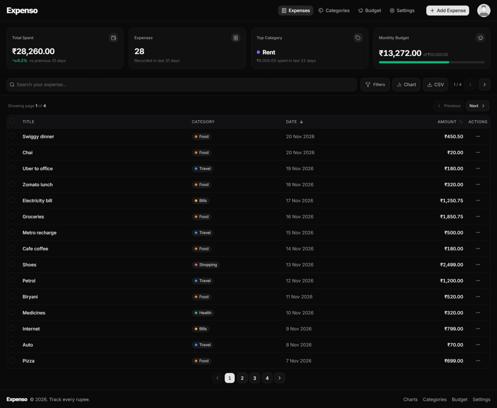

## Features

**Accounts and security**

- Signup and login with email + password (bcrypt hashed)
- Access token (15 min) + refresh token (7 days, httpOnly cookie)
- Refresh token rotation with reuse detection per token family
- Refresh tokens stored hashed (SHA-256) in the database
- Session restore on page reload, silent refresh on 401
- Password reset by email (hashed single-use token, 15 min expiry, all sessions revoked after reset)
- Change password (needs the current password, signs out every other device, sends a confirmation email)
- Session management: see every signed-in device (browser, OS, IP, last active), sign out one device or all others
- Rate limiting on signup, login, forgot-password, reset-password and change-password
- Profile update and avatar upload (Cloudinary)
- Hourly cleanup job for expired and revoked refresh tokens

**Expenses**

- Expenses CRUD with filters (category, date range, amount, payment method), search, sort and offset pagination
- Numbered pagination (1 2 3 … 12) above and below the table
- Bulk delete: select rows on a page and delete them in one go (up to 100 at a time)
- CSV export that follows the current filters
- Filters, sort and page are kept in the URL, so a reload or a shared link shows the same view
- Responsive table: cards with checkboxes on mobile, a full table on larger screens

**Categories and budget**

- Default categories created for every new user (transactional)
- Categories CRUD (per-user, case-insensitive unique names, color picker)
- Monthly budget with a progress bar (spent vs budget, amount left or over budget)

**Dashboard and charts**

- Summary cards: total spent with change vs the previous period, number of expenses, top category, monthly budget
- Chart page with a range selector (7D, 1M, 3M), a bar chart (daily or weekly) with a category filter, and a pie chart by category

**App shell**

- Header with Categories, Budget and Settings buttons on large screens (the profile menu is used on smaller screens)
- Settings page: profile (name and photo), change password, active sessions
- Forgot and reset password pages
- Protected routes, footer, loading and empty states

## Tech Stack

| Layer    | Tech                                                                                                                      |
| -------- | ------------------------------------------------------------------------------------------------------------------------- |
| Frontend | React, TypeScript, Vite, Tailwind CSS, shadcn/ui, TanStack Query, React Router, React Hook Form, Zod, Axios, Recharts    |
| Backend  | Bun, Express, TypeScript, Zod, Multer, Cloudinary, node-cron, express-rate-limit, Brevo (transactional email API)         |
| Database | PostgreSQL, Drizzle ORM                                                                                                   |

## Auth Design

1. Login returns a short-lived access token in the response body. The frontend keeps it in memory only, never in localStorage.
2. The refresh token is set as an httpOnly cookie (`path=/api/account`, `sameSite=lax`, `secure` in production), so JavaScript cannot read it. Only its SHA-256 hash is stored in the DB.
3. When the access token expires, the API returns 401. An axios interceptor calls `/account/refresh` once (concurrent requests share the same promise) and retries the original request.
4. Every refresh rotates the token: the old one is revoked and a new one is issued in the same family.
5. If a revoked token is used again, the whole family is revoked, which signs that session out.

**Sessions:** one token family is one signed-in device. Each refresh token row stores the user agent, IP address and the time the session started, so the Settings page can list active devices. Signing out a device revokes its whole family. The current device is found from the refresh-token cookie, so it is marked "This device" and is never signed out by "Sign out all others".

**Change password:** the request needs the current password. A wrong password returns 400, not 401, because the frontend treats 401 as an expired access token. On success the password is updated and every session except the current one is revoked in one transaction, then a confirmation email is sent.

**Password reset:** `forgot-password` always returns the same response, whether or not the email exists. A random token is emailed as a link, and only its SHA-256 hash is stored with a 15 minute expiry. Using the token is a single atomic update (marks it used, changes the password, and deletes all refresh tokens), so a link works only once and every device is signed out.

**Rate limits** (kept in memory, per IP):

| Route                              | Limit                                    |
| ---------------------------------- | ---------------------------------------- |
| Signup                             | 10 per hour                              |
| Login                              | 10 failed attempts per 15 minutes        |
| Forgot and reset password          | 5 per 15 minutes                         |
| Change password                    | 5 failed attempts per 15 minutes         |

**Known limitations**

- No grace window for slow networks (two refreshes at the same moment can sign a device out).
- No email verification yet.
- Rate limits are kept in memory, so they reset when the server restarts.
- Expired and used password reset tokens are not cleaned up yet (refresh tokens are).
- A device that was signed out keeps a working access token for up to 15 minutes.
- Sessions show the IP address only, not a location.
- Select all in the table selects the current page only, and CSV export is capped at 20,000 rows.
- No income tracking yet, and the `expenses.date` column stores a date only (no time of day).

## API

All routes are under `/api`. Signup, login, refresh and the password reset routes don't need a bearer token (refresh uses the refresh-token cookie). Everything else, including logout, requires `Authorization: Bearer <accessToken>`.

| Method | Path                         | Description                                                                |
| ------ | ---------------------------- | -------------------------------------------------------------------------- |
| POST   | `/account/create`            | Sign up                                                                    |
| POST   | `/account/login`             | Log in                                                                     |
| POST   | `/account/refresh`           | Rotate refresh token, get a new access token                               |
| POST   | `/account/logout`            | Revoke the current refresh token                                           |
| GET    | `/account/me`                | Current user                                                               |
| PATCH  | `/account/update`            | Update first and last name                                                 |
| PATCH  | `/account/update/avatar`     | Upload avatar (JPG, PNG or WebP, max 2 MB, stored on Cloudinary)           |
| POST   | `/account/password/forgot`   | Email a password reset link (always responds the same)                     |
| PUT    | `/account/password/reset`    | Set a new password using the emailed token                                 |
| PUT    | `/account/password/change`   | Change password (`currentPassword`, `newPassword`), signs out other devices |
| GET    | `/account/sessions`          | List active sessions (device, IP, started, last active, `isCurrent`)       |
| DELETE | `/account/sessions`          | Sign out every session except the current one                              |
| DELETE | `/account/sessions/:id`      | Sign out one session                                                       |
| GET    | `/category/list`             | List categories (`?q=` search)                                             |
| POST   | `/category/create`           | Create category                                                            |
| PATCH  | `/category/:id/update`       | Update category                                                            |
| DELETE | `/category/:id/delete`       | Delete category (its expenses become uncategorized)                        |
| GET    | `/expense/list`              | List with filters, search, sort, pagination                                |
| GET    | `/expense/export`            | Download expenses as CSV (same filters as list, without `page` and `limit`) |
| GET    | `/expense/summary`           | Total, count, previous period total and top category for a date range      |
| GET    | `/expense/by-category`       | Category-wise totals for a date range (pie chart)                          |
| GET    | `/expense/trend`             | Daily (up to 31 days) or weekly totals, optional `categoryId` (bar chart)  |
| POST   | `/expense/create`            | Create expense                                                             |
| POST   | `/expense/bulk-delete`       | Delete several expenses (`{ "ids": [...] }`, 1 to 100 ids)                 |
| GET    | `/expense/:id/details`       | Expense details                                                            |
| PATCH  | `/expense/:id/update`        | Update expense                                                             |
| DELETE | `/expense/:id/delete`        | Delete expense                                                             |
| GET    | `/budget`                    | Budget and amount spent for a month (`?month=YYYY-MM`)                     |
| PUT    | `/budget`                    | Set or update the budget for a month (`{ month, amount }`)                 |
| DELETE | `/budget`                    | Remove the budget for a month (`?month=YYYY-MM`)                           |

**Expenses list query params:** `page`, `limit` (max 50), `q`, `categoryId`, `paymentMethod`, `from`, `to`, `minAmount`, `maxAmount`, `sort` (`date_desc`, `date_asc`, `amount_desc`, `amount_asc`)

**Summary, by-category and trend query params:** `from` and `to` (`YYYY-MM-DD`, max 366 days apart). `trend` also accepts an optional `categoryId`.

**CSV export:** cells that start with `=`, `+`, `-` or `@` are prefixed with a quote, so spreadsheet apps do not run them as formulas.

## Frontend Routes

| Path                       | Page                                              |
| -------------------------- | ------------------------------------------------- |
| `/account/login`           | Log in                                            |
| `/account/create`          | Sign up                                           |
| `/account/password/forgot` | Ask for a password reset link                     |
| `/reset-password?token=…`  | Set a new password (opened from the email link)   |
| `/`                        | Dashboard: summary cards, search, filters, table  |
| `/chart`                   | Bar chart and pie chart                           |
| `/categories`              | Manage categories                                 |
| `/budget`                  | Monthly budget and progress                       |
| `/settings`                | Profile, change password, active sessions         |

## Getting Started

### Prerequisites

- [Bun](https://bun.sh)
- PostgreSQL
- A [Cloudinary](https://cloudinary.com) account (avatar upload)
- A [Brevo](https://www.brevo.com) account and API key (password emails)

### Backend

```bash
cd backend
cp .env.example .env     # fill in the values
bun install
bun run db:push          # creates the tables
bun run dev
```

The API runs on `http://localhost:5000` by default.

Database scripts:

| Script                | What it does                                   |
| --------------------- | ---------------------------------------------- |
| `bun run db:push`     | Push the schema straight to the database (dev) |
| `bun run db:generate` | Generate a SQL migration from schema changes   |
| `bun run db:migrate`  | Apply the generated migrations                 |
| `bun run db:studio`   | Open Drizzle Studio                            |

Optional: load sample expenses for an existing account (about 50 expenses over the last 3 months). Run it from the `backend` folder:

```bash
bun run scripts/seed-expenses.ts you@example.com
```

### Frontend

```bash
cd frontend
cp .env.example .env
bun install
bun run dev
```

The app runs on `http://localhost:5173`. Set `FRONTEND_URL=http://localhost:5173` in `backend/.env`, otherwise CORS and the password reset link will not work.

### Environment variables

`backend/.env`

| Variable                | Description                                                      |
| ----------------------- | ---------------------------------------------------------------- |
| `PORT`                  | API port (default `5000`)                                        |
| `NODE_ENV`              | `development` or `production` (production makes the cookie `secure`) |
| `DATABASE_URL`          | PostgreSQL connection string                                     |
| `BACKEND_URL`           | Public URL of the API                                            |
| `FRONTEND_URL`          | URL of the frontend (CORS origin and base of the reset link)     |
| `ACCESS_TOKEN_SECRET`   | Long random string used to sign access tokens                    |
| `CLOUDINARY_CLOUD_NAME` | Cloudinary cloud name                                            |
| `CLOUDINARY_API_KEY`    | Cloudinary API key                                               |
| `CLOUDINARY_API_SECRET` | Cloudinary API secret                                            |
| `BREVO_API_URL`         | Brevo transactional email endpoint                               |
| `BREVO_API_KEY`         | Brevo API key                                                    |
| `BREVO_USER`            | Sender email address (also shown as the support address)         |

`frontend/.env`

```
VITE_API_URL=http://localhost:5000
```

Use the server address only, without `/api` at the end. The app adds it.

## Deployment Notes

- Set `NODE_ENV=production` on the backend so the refresh cookie is sent only over HTTPS.
- The refresh cookie uses `sameSite=lax`, so the frontend and the API should look like the same site to the browser. `frontend/vercel.json` proxies `/api/*` to the backend for this reason. Change its `destination` to your own backend URL.
- `FRONTEND_URL` must match the frontend origin exactly (no trailing slash), because it is the CORS origin.

## Project Structure

```
expenso/
  backend/
    controllers/  routers/  validations/  middleware.ts
    db/           # Drizzle schema
    drizzle/      # generated SQL migrations
    config/       # env and constants
    lib/          # tokens, mailer, cloudinary, helpers
    rateLimit/    # express-rate-limit setup
    cron/         # hourly token cleanup
    templates/    # email templates
    scripts/      # seed script
  frontend/
    src/
      api/          # axios calls
      hooks/        # React Query hooks
      components/   # app components (ui/ holds shadcn components, settings/ the settings sections)
      pages/        # account, home, chart, categories, budget, settings
      layouts/ routes/ context/ validations/ lib/
  docs/             # screenshots
```

## Screenshots

### Dashboard


### Charts

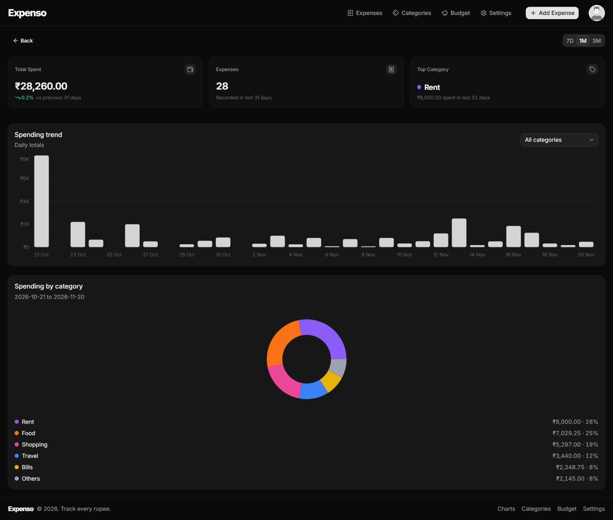

### Login and sign up

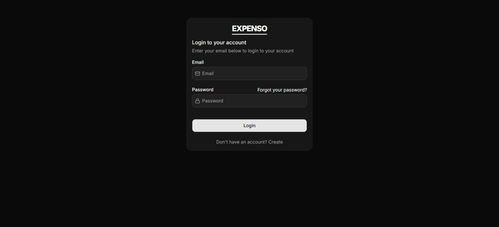
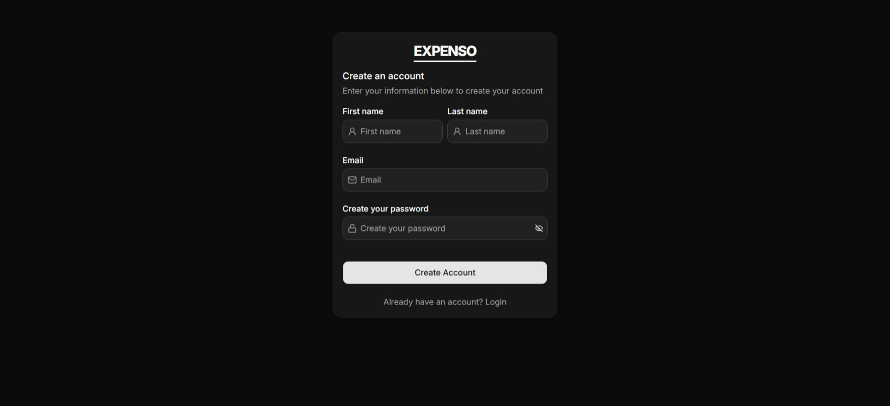

### Forgot password

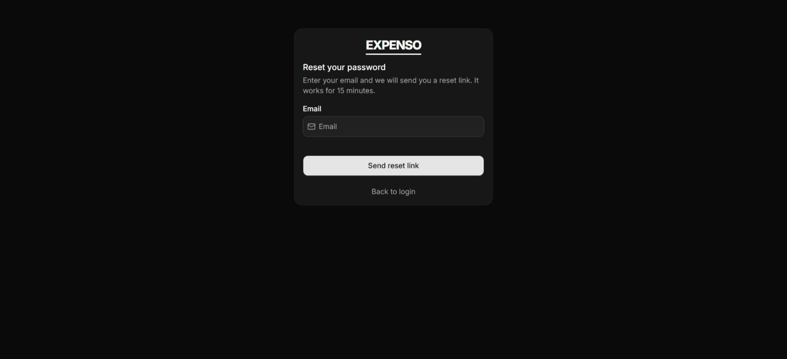

### Add expense

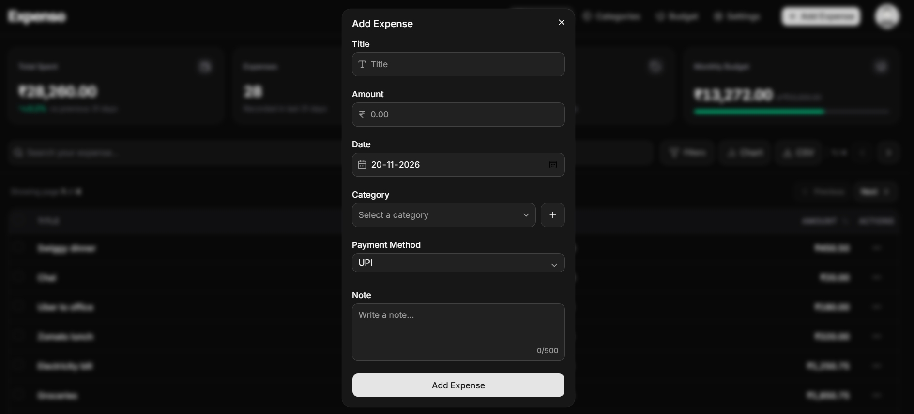

### Filters

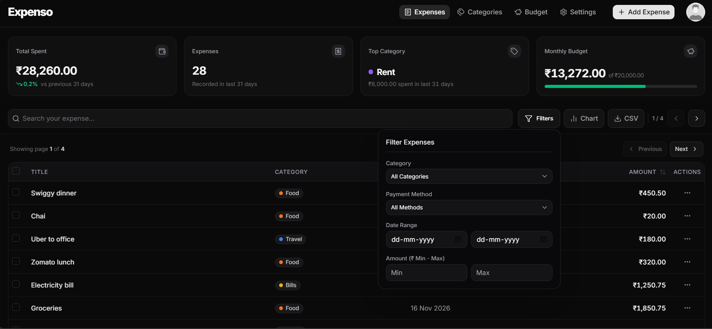

### Bulk delete and pagination

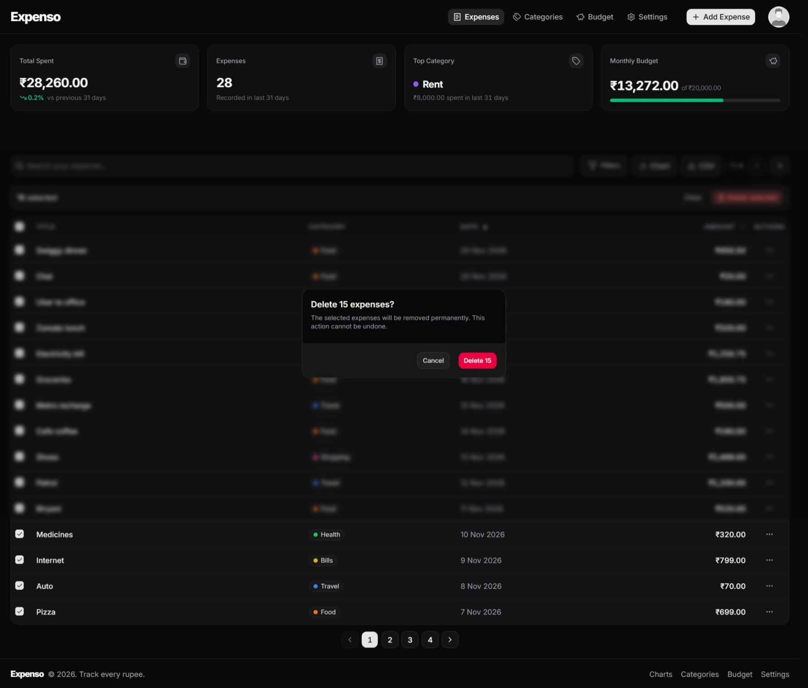

### Categories

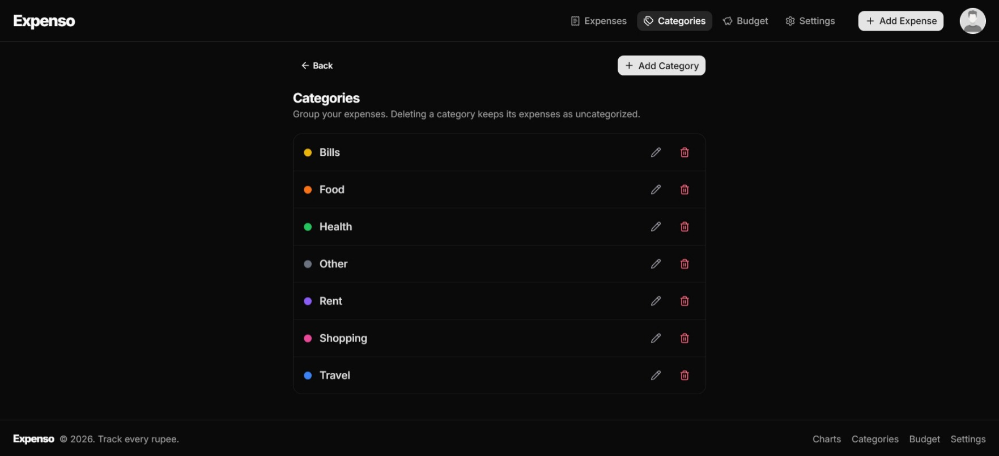

### Budget

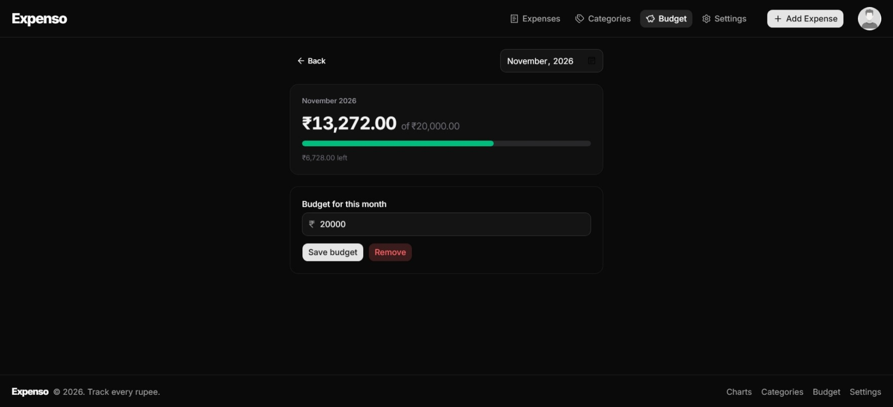

### Settings (profile, change password, active sessions)

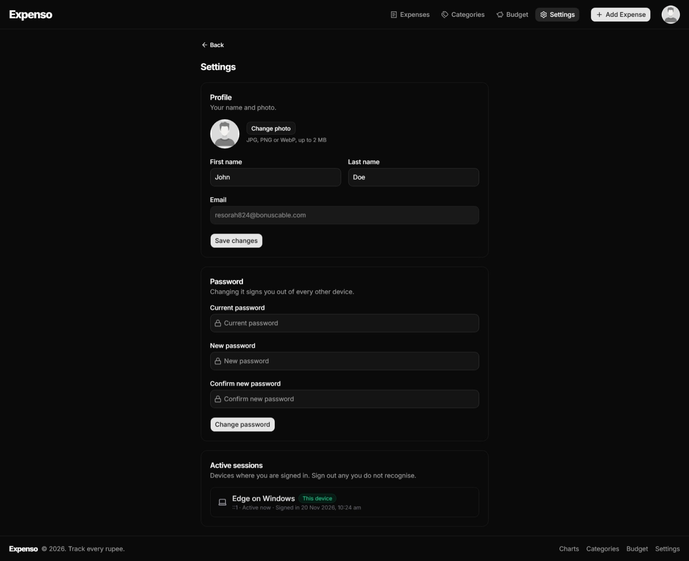
